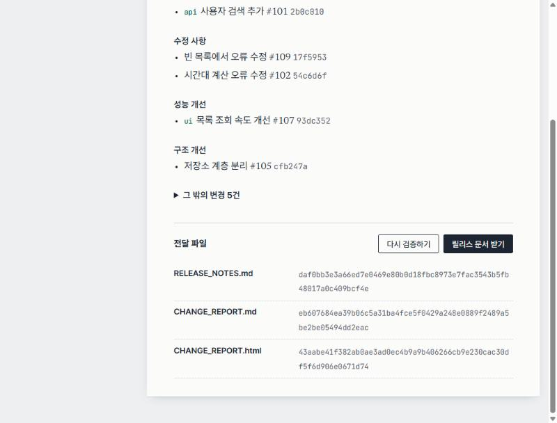
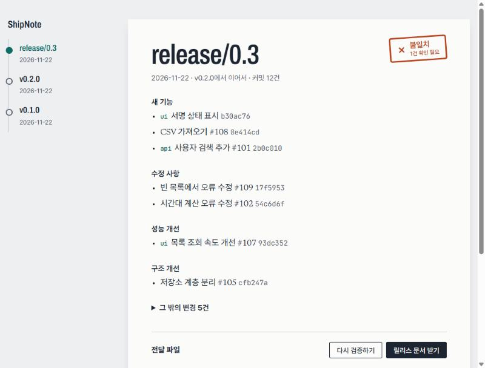

# ShipNote

Git 태그 하나로 릴리스 노트, 변경 보고서, 협력사 전달용 패키지(zip + SHA-256 + Ed25519 서명)를 자동으로 만들고, 만든 이력을 웹 화면에서 다시 검증하며 찾아보는 도구입니다. TypeScript로 CLI, API 서버, React 화면을 모두 구현했습니다.

## 프로젝트 소개 (지원서용)

릴리스마다 반복되는 문서 작업을 줄이고, 협력사에 보낸 산출물이 전달 과정에서 바뀌지 않았다는 것을 증명할 수 있도록 만든 프로젝트입니다. `shipnote release v1.2.0 --key shipnote.key` 한 줄이면 직전 태그부터 해당 태그까지의 커밋을 읽어 분류하고, 사용자용 릴리스 노트와 협력사용 변경 보고서를 만들고, 파일별 SHA-256이 담긴 매니페스트에 서명해 zip으로 묶은 뒤 SQLite에 기록합니다. 받는 쪽은 미리 전달받은 공개키로 `shipnote verify --pubkey shipnote.pub`를 실행해 파일이 하나라도 달라졌는지, 보낸 사람이 만든 것이 맞는지 바로 확인할 수 있습니다.

- **역할:** 기획, 설계, 구현, 테스트, 배포 자동화까지 혼자 진행했습니다.
- **기술:** TypeScript, Node.js 24(내장 SQLite·Ed25519), React + Vite, Vitest, Docker, GitHub Actions
- **규모:** CLI·서버 약 880줄, 웹 화면 약 330줄(CSS 포함), 테스트 59건. 실행 의존성은 zip 처리용 `fflate` 하나입니다(React와 글꼴은 빌드에만 사용).

### 이 프로젝트에서 신경 쓴 점

1. **무결성 검증을 핵심 기능으로 삼았습니다.** 해시는 파일 바이트 기준으로 계산하고, 검증은 변조·누락·매니페스트에 없는 파일·`../` 같은 경로 탈출 이름·크기 불일치를 모두 실패로 처리합니다. 매니페스트 자체를 다시 계산해 끼워 넣는 위조는 해시만으로 막을 수 없으므로 Ed25519 서명으로 막습니다. "파일을 바꾸고 매니페스트까지 다시 계산해도 서명에서 걸린다"는 테스트가 있습니다.
2. **입력을 믿지 않습니다.** 태그 이름은 git 옵션으로 오해되지 않도록 엄격히 검사하고, 커밋 메시지는 HTML 출력 전에 이스케이프합니다. 받은 zip은 항목 수와 압축 해제 크기에 상한을 두어 zip 폭탄을 풀지 않고 거부하며, 매니페스트는 필드 타입과 이름 중복까지 확인합니다. API 서버는 웹 루트 밖 경로(이름이 비슷한 옆 폴더 포함)를 막습니다.
3. **실패해도 기존 산출물을 망가뜨리지 않습니다.** 같은 태그를 다시 만들려 하면 기존 zip을 건드리기 전에 거부하고, zip은 임시 파일에 쓴 뒤 DB 기록이 끝나야 최종 이름으로 바꿉니다.
4. **지저분한 이력도 처리합니다.** Conventional Commits가 아닌 메시지는 실패로 버리지 않고 '기타'로 모읍니다. `Feat:`처럼 대문자로 쓴 타입, git이 만드는 `Revert "..."` 메시지, 본문에 줄바꿈이 있는 커밋, 첫 릴리스(직전 태그 없음), `release/1.0`처럼 `/`가 들어간 태그도 처리합니다.
5. **구성 요소를 작게 나눴습니다.** 파서, 분류기, 렌더러, 패키저, 서명, 검증기, DB가 각각 독립된 모듈이라 따로 테스트할 수 있습니다. 새 의존성은 꼭 필요한 곳에만 추가했습니다.
6. **화면은 이 도구의 쓰임에 맞췄습니다.** 화물 인수증이라는 소재에서 출발해, 릴리스 목록은 시간순 세로선으로, 본문은 종이 한 장으로, 검증 결과는 도장으로 표현했습니다. 글꼴을 빌드에 함께 넣어 폐쇄망에서도 같은 화면이 나옵니다.

## 화면

### 릴리스 이력과 검증 완료 도장

왼쪽은 릴리스를 시간순으로 꿴 목록이고, 오른쪽은 선택한 릴리스의 문서입니다. 화면을 열면 서버가 zip을 다시 읽어 체크섬과 서명을 확인하고, 결과를 우측 상단 도장으로 보여줍니다.


### 전달 파일과 체크섬

문서 아래쪽에는 전달 파일별 SHA-256이 나오고, 같은 화면에서 다시 검증하거나 zip을 내려받을 수 있습니다.



### 변조된 패키지

zip 파일이 달라지면 도장이 '불일치'로 바뀌고 확인할 항목 수가 표시됩니다. 위 화면은 일부러 zip 끝에 1바이트를 덧붙여 만든 상태입니다.



## 동작 흐름

```
git 저장소 → 파서(git log) → 분류기(feat/fix/…) → 렌더러(Markdown·HTML) → 패키저(zip + 매니페스트 + 서명) → SQLite → CLI·웹 화면
```

| 명령 | 설명 |
| --- | --- |
| `keygen` | Ed25519 키 쌍(`shipnote.key`, `shipnote.pub`)을 만듭니다. 옵션: `--out`, `--force` |
| `release <태그>` | 직전 태그부터 이 태그까지 읽어 문서와 zip을 만들고 DB에 기록합니다. 옵션: `--key`, `--from`, `--webhook`, `--force`, `--repo`, `--out`, `--db` |
| `verify <zip>` | zip을 풀어 해시를 다시 계산합니다. 하나라도 어긋나면 종료 코드 1을 돌려줍니다. 옵션: `--pubkey`, `--sha256` |
| `ls` | 기록된 릴리스 목록을 보여줍니다. |
| `serve` | 이력 화면과 API(`/api/releases`)를 서빙합니다. 옵션: `--pubkey`, `--host`, `--port`, `--web` |

`release`가 만드는 패키지에는 `RELEASE_NOTES.md`, `CHANGE_REPORT.md`, `CHANGE_REPORT.html`, `manifest.json`이 들어 있고, `--key`를 주면 `manifest.sig`가 추가됩니다. 태그에 `/`가 있으면 zip 파일 이름에서는 `~`로 바꿉니다(`release/1.0` → `shipnote-release~1.0.zip`).

## 무결성 보장 범위

| 받는 쪽이 확인하는 방법 | 알 수 있는 것 |
| --- | --- |
| `verify <zip>` (서명 없음) | 전송 중 손상, 파일 누락·추가. 누군가 파일과 매니페스트를 함께 바꿨다면 알 수 없습니다. 이때 경고를 출력합니다. |
| `verify <zip> --sha256 <값>` | zip 전체가 보낸 것과 같은지. 해시 값은 메일·메신저 등 zip과 다른 경로로 받아야 의미가 있습니다. |
| `verify <zip> --pubkey shipnote.pub` | 위 내용에 더해, 비밀키를 가진 사람이 만든 패키지인지. 공개키는 미리 한 번만 안전하게 전달하면 됩니다. |

비밀키(`*.key`)는 `.gitignore`에 들어 있으며 저장소에 올리지 않습니다. GitHub Actions에서는 저장소 시크릿 `SHIPNOTE_SIGNING_KEY`에 비밀키 PEM을 넣으면 서명하고, 공개키와 zip SHA-256을 GitHub Release에 함께 올립니다.

## 검증한 내용

- 단위·통합 테스트 59건(파서·분류기·서명·검증기·DB 마이그레이션·API·CLI 종료 코드·웹훅·웹 화면)과 타입 검사가 통과합니다.
- 커밋 110건짜리 샘플 저장소(태그 2개, 호환 불가 변경과 비표준 메시지 포함)로 서명한 릴리스를 만들고 `verify --pubkey`가 통과하는 것을 확인했습니다.
- `npm pack`으로 만든 패키지를 다른 폴더에 설치해 `npx shipnote`가 실행되는 것을 확인했습니다.
- Docker 이미지 안에서(비root 사용자) `keygen`, 서명 릴리스, 검증이 동작하는 것을 확인했습니다.
- 0.1.0에서 만든 DB를 열면 새 컬럼이 자동으로 추가되는 것을 확인했습니다.
- main 푸시와 PR마다 GitHub Actions가 타입 검사, 테스트, 빌드를 돌립니다. 태그를 푸시하면 문서 생성과 재검증을 거쳐 GitHub Release에 zip을 첨부합니다.

## 실행 방법

Node 24 이상이 필요합니다.

### 설치해서 쓰기

```
npm install -g github:dyj02056/ShipNote
shipnote keygen
shipnote release v1.0.0 --key shipnote.key
shipnote verify out/shipnote-v1.0.0.zip --pubkey shipnote.pub
shipnote serve --pubkey shipnote.pub              # http://127.0.0.1:4173
```

### 저장소에서 바로 실행하기

```
npm install
npm run sample                                    # 테스트용 저장소(.sample-repo) 생성
node src/cli.ts keygen
node src/cli.ts release v0.1.0 --repo .sample-repo --key shipnote.key
node src/cli.ts release v0.2.0 --repo .sample-repo --key shipnote.key
node src/cli.ts verify out/shipnote-v0.2.0.zip --pubkey shipnote.pub
npm run web:build && node src/cli.ts serve --pubkey shipnote.pub
```

`serve`는 인증이 없으므로 기본으로 `127.0.0.1`에만 엽니다. `--host 0.0.0.0`처럼 바깥에 열면 경고를 출력합니다.

### Docker

```
docker build -t shipnote .
docker run --rm --user "$(id -u):$(id -g)" -v "$PWD:/repo" -v "$PWD/out-docker:/work" shipnote keygen
docker run --rm --user "$(id -u):$(id -g)" -v "$PWD:/repo" -v "$PWD/out-docker:/work" shipnote release v0.2.0 --repo /repo --key shipnote.key
```

이미지는 root가 아닌 사용자로 실행되고, git은 `/repo` 경로만 신뢰합니다. 저장소는 `/repo`, 산출물은 `/work`에 마운트하세요.

### 개발

- 테스트: `npm test`, 타입 검사: `npm run typecheck`
- CLI 빌드(`dist/`): `npm run build`, 웹 화면 빌드(`web/dist/`): `npm run web:build`

## 한계와 다음 단계

- 커밋 메시지가 Conventional Commits라고 가정합니다. 형식이 아니면 '기타'로 분류합니다.
- 대용량 저장소를 위한 병렬 파싱(worker_threads)은 아직 넣지 않았습니다. 수천 건 이상에서 느려지는 것을 측정한 뒤 추가할 계획입니다.
- 로컬 모델(Ollama)로 변경 요약 초안을 만드는 기능은 아직 없습니다.
- 웹훅은 로컬 테스트 서버로만 검증했고 실제 서비스(Slack 등)로는 시험하지 못했습니다.
- 키 폐기·교체 이력은 관리하지 않습니다. 키를 바꾸면 받는 쪽에 새 공개키를 다시 전달해야 합니다.

## 라이선스

MIT. 웹 화면에 포함된 글꼴(Pretendard, Archivo, Newsreader, JetBrains Mono)은 SIL Open Font License 1.1을 따릅니다.
