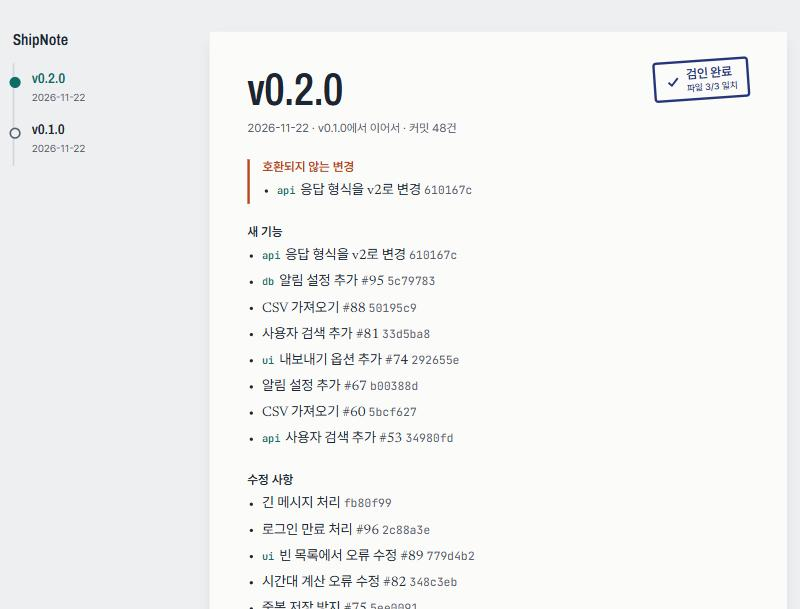

# ShipNote

Git 태그 하나로 릴리스 노트, 변경 보고서, 협력사 전달용 패키지(zip + SHA-256 체크섬)를 자동으로 만들고, 만든 이력을 웹 화면에서 다시 검증하며 찾아보는 도구입니다. TypeScript로 CLI, API 서버, React 화면을 모두 구현했습니다.

## 프로젝트 소개 (지원서용)

릴리스마다 반복되는 문서 작업을 줄이고, 협력사에 보낸 산출물이 전달 과정에서 바뀌지 않았다는 것을 증명할 수 있도록 만든 프로젝트입니다. `shipnote release v1.2.0` 한 줄이면 직전 태그부터 해당 태그까지의 커밋을 읽어 분류하고, 사용자용 릴리스 노트와 협력사용 변경 보고서를 만들고, 파일별 SHA-256이 담긴 zip으로 묶어 SQLite에 기록합니다. 받는 쪽은 `shipnote verify`로 파일이 하나라도 달라졌는지 바로 확인할 수 있습니다.

- **역할:** 기획, 설계, 구현, 테스트, 배포 자동화까지 혼자 진행했습니다.
- **기술:** TypeScript, Node.js 24(내장 SQLite), React + Vite, Vitest, Docker, GitHub Actions
- **규모:** 소스 약 870줄(CLI·서버 550줄, 웹 화면 320줄), 테스트 22건, 외부 의존성은 zip 처리용 `fflate` 하나(웹 화면용 React 제외)

### 이 프로젝트에서 신경 쓴 점

1. **무결성 검증을 핵심 기능으로 삼았습니다.** 해시는 파일 바이트 기준으로 계산하고, 검증은 변조·누락·매니페스트에 없는 파일·`../` 같은 경로 탈출 이름을 모두 실패로 처리합니다. "파일 한 바이트를 바꾸면 검증이 실패한다"는 테스트를 가장 먼저 만들었습니다.
2. **입력을 믿지 않습니다.** 태그 이름은 git 옵션으로 오해되지 않도록 엄격히 검사하고, 커밋 메시지는 HTML 출력 전에 이스케이프하며, API 서버는 웹 루트 밖의 경로를 막습니다.
3. **지저분한 이력도 처리합니다.** Conventional Commits가 아닌 메시지는 실패로 버리지 않고 '기타'로 모읍니다. 본문에 줄바꿈이 있는 커밋과 첫 릴리스(직전 태그 없음)도 처리합니다.
4. **구성 요소를 작게 나눴습니다.** 파서, 분류기, 렌더러, 패키저, 검증기, DB가 각각 독립된 모듈이라 따로 테스트할 수 있습니다. 새 의존성은 꼭 필요한 곳에만 추가했습니다.
5. **화면은 이 도구의 쓰임에 맞췄습니다.** 화물 인수증이라는 소재에서 출발해, 릴리스 목록은 시간순 세로선으로, 본문은 종이 한 장으로, 검증 결과는 도장으로 표현했습니다.

## 화면

### 릴리스 이력과 검증 완료 도장

왼쪽은 릴리스를 시간순으로 꿴 목록이고, 오른쪽은 선택한 릴리스의 문서입니다. 화면을 열면 서버가 zip을 다시 읽어 체크섬을 확인하고, 결과를 우측 상단 도장으로 보여줍니다.



### 전달 파일과 체크섬

문서 아래쪽에는 전달 파일별 SHA-256이 나오고, 같은 화면에서 다시 검증하거나 zip을 내려받을 수 있습니다.


### 변조된 패키지

zip 파일이 달라지면 도장이 '불일치'로 바뀌고 확인할 항목 수가 표시됩니다. 위 화면은 일부러 zip 끝에 1바이트를 덧붙여 만든 상태입니다.


## 동작 흐름

```
git 저장소 → 파서(git log) → 분류기(feat/fix/…) → 렌더러(Markdown·HTML) → 패키저(zip + 매니페스트) → SQLite → CLI·웹 화면
```

| 명령 | 설명 |
| --- | --- |
| `release <태그>` | 직전 태그부터 이 태그까지 읽어 문서와 zip을 만들고 DB에 기록합니다. 옵션: `--from`, `--webhook`, `--force` |
| `verify <zip>` | zip을 풀어 해시를 다시 계산합니다. 하나라도 어긋나면 종료 코드 1을 돌려줍니다. |
| `ls` | 기록된 릴리스 목록을 보여줍니다. |
| `serve` | 이력 화면과 API(`/api/releases`)를 서빙합니다. |

`release`가 만드는 패키지에는 `RELEASE_NOTES.md`, `CHANGE_REPORT.md`, `CHANGE_REPORT.html`, `manifest.json`이 들어 있습니다.

## 검증한 내용

- 단위·통합 테스트 22건과 타입 검사가 통과합니다.
- 커밋 110건짜리 샘플 저장소(태그 2개, 호환 불가 변경과 비표준 메시지 포함)로 릴리스 2건을 만들고 `verify`가 통과하는 것을 확인했습니다.
- 태그를 푸시하면 GitHub Actions가 테스트, 문서 생성, 재검증을 거쳐 GitHub Release에 zip을 첨부합니다. 실제로 `v0.1.0`에서 성공했습니다.
- `docker run`으로 같은 명령이 컨테이너 안에서도 동작합니다.

## 실행 방법

Node 24 이상이 필요합니다.

```
npm install
npm run sample                                    # 테스트용 저장소(.sample-repo) 생성
node src/cli.ts release v0.1.0 --repo .sample-repo
node src/cli.ts release v0.2.0 --repo .sample-repo
node src/cli.ts verify out/shipnote-v0.2.0.zip
npm run web:build && node src/cli.ts serve        # http://127.0.0.1:4173
```

Docker:

```
docker build -t shipnote .
docker run --rm -v "$PWD:/repo" -v "$PWD/out-docker:/work" shipnote release v0.2.0 --repo /repo
```

테스트: `npm test`, `npm run typecheck`

## 한계와 다음 단계

- 커밋 메시지가 Conventional Commits라고 가정합니다. 형식이 아니면 '기타'로 분류합니다.
- 대용량 저장소를 위한 병렬 파싱(worker_threads)은 아직 넣지 않았습니다. 수천 건 이상에서 느려지는 것을 측정한 뒤 추가할 계획입니다.
- 로컬 모델(Ollama)로 변경 요약 초안을 만드는 기능은 아직 없습니다.
- 웹훅 전송은 구현했지만 실제 수신 서버로는 시험하지 못했습니다.
- 웹 화면의 글꼴은 Google Fonts와 jsDelivr에서 받습니다. 오프라인에서 쓰려면 글꼴 파일을 함께 넣어야 합니다.
